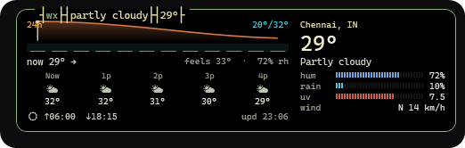

# Windows Dynamic Bar

**A modern, lightweight Dynamic-Island-style overlay for Windows 10 and Windows 11 with a living desktop companion.**

[](CHANGELOG.md)
[](https://dotnet.microsoft.com/)
[](https://microsoft.com/windows)
[](LICENSE.md)

---

## Overview

**Windows Dynamic Bar** brings an interactive, context-aware pill interface to the top of your desktop. Inspired by mobile dynamic islands, it stays compact and unobtrusive during daily work, then smoothly expands with fluid spring physics when you play media, set timers, inspect hardware telemetry, search for apps, or adjust volume and display brightness.

Featuring **Dot**—a living pixel-art desktop companion living right inside your island pill that reacts in real time to your daily PC workflow with expressive animations, procedural pixel props, and zero background telemetry.

The application is **100% local-only and privacy-first**: no background analytics or network telemetry are transmitted to remote servers, no account is required, and your clipboard history remains encrypted on your machine using Windows DPAPI.


*Windows Dynamic Bar resting cleanly above your desktop workflow with media title, battery gauge, clock, and companion.*

---

## Key Features

- **Living Desktop Companion (Dot)** — An interactive pixel-art companion living directly in the bar. Reacts in real time to Windows system events: taking screenshots with instant smartphone photo reviews, Caps Lock pop-out letters, Wi-Fi wave arcs, VPN security shields, charging electricity munches, over-ear DJ headphones, mic/camera privacy poses, treadmill running sprints, and interactive petting with hearts.
- **Media Player & Visualizer** — Real-time album art, track details, seek progress, playback controls (Previous, Play/Pause, Next), and time-synchronized lyrics (LRCLib) with an optional rotating vinyl/CD disc animation.
- **System Telemetry & Hardware Monitor** — Real-time CPU usage, GPU engine load via DXGI enumeration, 16-core heatmap, memory utilization rings, ACPI thermal zones, battery status with a 15% warning strip, and Per-Monitor DPI V2 support.
- **Search Launcher & Window Switcher** — Instant launcher (`Ctrl+Space`) with fuzzy app matching, window switching (`w `), math evaluation, and direct Buddy command control (`> buddy-acc`, `> buddy-anim`, `> buddy-pet`).
- **Countdown Timer & Stopwatch** — Quick presets (5m, 10m, 25m, 45m), natural language parser (`15 min`, `90s`, `1:30`), and a retro digital LED dot-matrix countdown.
- **Encrypted Clipboard History** — `WM_CLIPBOARDUPDATE` event-driven capture with zero polling, DPAPI encryption at rest, and automatic password manager exclusions (1Password, KeePass, Bitwarden).
- **Network & Speed Test** — RSSI signal bars (`wlanapi.dll`), live transfer throughput, ping latency probes (Gateway, DNS, Cloudflare, Google), and integrated bandwidth testing with Dot's treadmill sprint reaction.
- **Volume & Brightness HUD** — Dynamic on-screen display with dot-matrix spectrum visualization when system sliders or volume keys change.
- **Customizable Appearance** — Dark, Light, and Translucent themes, 9 accent colors, adjustable corner radius, width, height, and animation speed.
- **Gaming & Fullscreen Protection** — Automatically hides in fullscreen games and video playback.

---

## Living Desktop Companion: Dot

Dot lives right inside the Dynamic Island pill, keeping you company and giving instant, playful visual feedback on everything happening on your PC.

### Real-Time System Status Reactions

| System Event | Action on Your PC | What Dot Does |
| :--- | :--- | :--- |
| **Screenshot Capture** | Press <kbd>Win</kbd> + <kbd>Shift</kbd> + <kbd>S</kbd> | Camera flash snaps, then Dot pulls out his smartphone with both paws displaying your screenshot on the screen with a wink. |
| **Caps Lock Toggle** | Press <kbd>Caps Lock</kbd> | **ON:** Puffs up with a wide mouth and a golden pop-out letter **"A"** appears. **OFF:** Relaxes into a lowercase **"a"** in 0 ms. |
| **Clipboard Copy** | Press <kbd>Ctrl</kbd> + <kbd>C</kbd> | Holds up a metallic double-loop clipboard and nods. Copying an image shows a framed picture; copying files shows a cardboard box. |
| **Wi-Fi Connected** | Connect to a network | Antenna perks up, emits 3 sequential expanding Wi-Fi arcs, and does a happy hop. If offline >2 min, says *"We're back online!"*. |
| **Wi-Fi Disconnected** | Turn off Wi-Fi or disconnect | Antenna droops red, sits down, scratches his head, and holds up a **"?"** mark looking around. |
| **Airplane Mode** | Toggle Airplane Mode | **ON:** Puts on a pilot cap and glides with arms out holding an airplane. **OFF:** Lands with a hop and Wi-Fi waves. |
| **VPN Connected** | Connect to VPN | Stands 1 px taller, equips a green security shield with checkmark, and strikes a sunglasses pose. |
| **Battery Charging** | Plug in power cord | Holds a cable with yellow electrical sparks, antenna glows neon green, and he munches 3 times on electricity. At 100%, pats his belly. |
| **Low Battery Alert** | Battery drops to &le;15% | Yawns, walks at 60% speed with an alert **"!"**. At &le;10%, lies down on the floor in a power-saving nap until charged. |
| **Music Playback** | Play music (Spotify, YouTube, etc.) | Puts on over-ear DJ studio headphones with pulsing cyan beat LEDs, sways in an 8-step wave dance, and taps his foot with sound ripples. |
| **Microphone in Use** | Join call / unmute mic | Puts finger to mouth in a **"shh"** pose, sits down calmly, pauses any music dancing, and stays silent until the call ends. |
| **Camera in Use** | Open webcam / video call | Sits still facing forward, straightens his collar/outfit once, and stays calm. |
| **Do Not Disturb** | Toggle DND / Focus Assist | Pulls out a crescent golden Moon prop, half-closes his eyes, and drifts off to sleep with floating Zzz letters. |
| **Speed Test (>100 Mbps)** | Run network speed test | Jumps onto a side-view treadmill sprinting at 10.5 km/h with moving belt dashes, console display, and workout sweat. |
| **Petting Dot** | Click Dot (or press <kbd>Enter</kbd>) | Bounces in a continuous parabolic hop with rosy blushing cheeks and floating heart particles. |
| **Event Capsule Open** | Any capsule pops (Volume, Brightness) | Enters **Peek** pose: drops to bottom rim with only head and antenna visible over edge; eyes track the capsule icon, antenna matches event color. |

### Interactive Search Bar Commands (<kbd>Ctrl</kbd> + <kbd>Space</kbd>)

Press <kbd>Ctrl</kbd> + <kbd>Space</kbd> to open the search bar, then type any of these commands and press <kbd>Enter</kbd> to command Dot directly:

```text
> buddy-acc PhonePhoto     # Shows smartphone photo review
> buddy-acc Camera         # Equips camera prop
> buddy-acc WifiArcs       # Emits 3 expanding Wi-Fi wave arcs
> buddy-acc ShieldCheck    # Equips VPN shield with checkmark & shades
> buddy-acc CableSparks    # Charging cable with electrical sparks
> buddy-acc BatteryAlert   # Low battery warning prop
> buddy-acc Speaker        # Audio speaker cabinet prop
> buddy-acc Moon           # Crescent moon nighttime prop
> buddy-acc Plane          # Pilot cap with tiny airplane
> buddy-acc DizzyStars     # Orbiting dizzy stars
> buddy-anim Treadmill     # Sprints on side-view treadmill machine
> buddy-anim Hopping       # Parabolic jump animation
> buddy-anim Celebrating   # Victory celebration with confetti particles
> buddy-anim Inspecting    # Magnifying glass with 2x eye inspection
> buddy-anim Stretching    # Reaches tall arms overhead yawning
> buddy-pet                # Pets Dot immediately
> buddy-peek               # Triggers bottom-rim peek pose
> buddy-card               # Opens customization Buddy Card
> buddy-outfit WizardHat   # Equips star-tipped wizard hat
> buddy-outfit Crown       # Equips golden royal crown
> buddy-quiet off          # Enables speech bubbles and chatter
> buddy-quiet on           # Mutes speech bubbles (visual reactions stay active)
```

---

## Screenshot Gallery

| Collapsed Dynamic Bar | Expanded Island Card |
| :---: | :---: |
|  |  |
| *Compact pill showing song title, battery badge, clock, and companion* | *Expanded card with media controls & telemetry chips* |

| Living Companion (Dot) | System Telemetry Monitor |
| :---: | :---: |
|  |  |
| *Dot reacting in real time with over-ear DJ headphones and props* | *btop-style CPU load, core heatmap, ACPI temp & top procs* |

| Network & Speed Test | Countdown Timer & Stopwatch |
| :---: | :---: |
|  |  |
| *Mirrored transfer rate, ping latency probes & treadmill speed test* | *LED digital countdown, progress bar, presets & controls* |

| Encrypted Clipboard History | Search Launcher (`Ctrl+Space`) |
| :---: | :---: |
|  |  |
| *DPAPI encrypted history with pinned clips & search* | *Fuzzy app search, tab commands & direct buddy control* |

| Weather Forecast Panel | Settings & Hotkey Configuration |
| :---: | :---: |
|  |  |
| *24-hour temperature curve, UV index, and precipitation* | *Customizable themes, accents, hotkeys & buddy reaction toggles* |

*For more screenshots, see the [Full Screenshot Gallery](docs/SCREENSHOTS.md).*

---

## Install & Run

Windows Dynamic Bar targets **64-bit Windows 10/11** and does not require administrative privileges.

> **Status:** no prebuilt installer is published on the Releases page yet. Build it from source (Option 1) or use the `island` command (Option 2). `build-release.ps1` can produce a per-user installer and a portable zip locally, as described below.

### Option 1: Build and run from source

```powershell
git clone https://github.com/Super-cod/dynamic-island.git
cd dynamic-island
dotnet build src/WindowsDynamicBar/WindowsDynamicBar.csproj -c Release
dotnet run --project src/WindowsDynamicBar/WindowsDynamicBar.csproj -c Release
```

Requires the .NET 8 SDK (see Developer Setup below).

### Option 2: Terminal command (`island`)

You can manage, rebuild, and run Windows Dynamic Bar directly from your terminal using the built-in PowerShell CLI command named **`island`**.

#### Initial Setup
Open PowerShell and run the setup script:

```powershell
.\island.ps1
```

1. **First-time configuration:** When you run `island.ps1` for the first time, it will prompt you for the path to your project repository:
   ```text
   Please provide the location of your project repository [C:\Path\To\dynamic-island]:
   ```
2. Press **Enter** to accept the current repository or enter a custom path.
3. The script permanently saves your repository location in `~/.island/config.json` and automatically registers the `island` command into your PowerShell profile.
4. Open any terminal or directory — you can now use `island` from anywhere!

#### Command Options

| Command | Action |
|---|---|
| `island` | Stops any running instance and launches the application. |
| `island -Stop` | Gracefully terminates any running instance of the application. |
| `island -Build` | Stops the running instance, rebuilds the application in Release configuration, and launches the updated binary. |

---

## Production Executable & Artifact Locations

When working from source or setting up shortcuts, binaries are located at:

- **Primary Release Executable:**
  `src/WindowsDynamicBar/bin/Release/net8.0-windows10.0.19041.0/WindowsDynamicBar.exe`
- **Self-Contained Standalone Executable (Publish):**
  `src/WindowsDynamicBar/bin/Release/net8.0-windows10.0.19041.0/win-x64/publish/WindowsDynamicBar.exe`
- **Mirrored Launcher Executable:**
  `src/WindowsDynamicBar/bin/Release/net8.0-windows10.0.19041.0/win-x64/WindowsDynamicBar.exe`
- **Release Package Artifacts:**
  - `release/WindowsDynamicBar-Setup.exe` (per-user installer)
  - `release/WindowsDynamicBar-Portable-win-x64.zip` (portable archive)
  - `release/checksums.txt` (SHA-256 integrity hashes)

---

## Keyboard Shortcuts

| Shortcut | Action |
| :--- | :--- |
| <kbd>Ctrl</kbd> + <kbd>Space</kbd> | Opens the search bar & command launcher. |
| <kbd>Win</kbd> + <kbd>Shift</kbd> + <kbd>S</kbd> | Snips a screenshot & triggers Dot's smartphone photo review. |
| <kbd>Ctrl</kbd> + <kbd>C</kbd> | Copies text, images, or files & triggers Dot's clipboard reaction. |
| <kbd>Caps Lock</kbd> | Toggles Caps Lock & triggers Dot's pop-out letter "A" in 0 ms. |
| <kbd>Ctrl</kbd> + <kbd>Alt</kbd> + <kbd>Space</kbd> | Toggles the Dynamic Bar visibility. |
| <kbd>Ctrl</kbd> + <kbd>Alt</kbd> + <kbd>M</kbd> | Toggles the expanded Media player card. |
| <kbd>Esc</kbd> | Dismisses the active expanded panel, search bar, or detail card. |

---

## Developer Setup & Build Instructions

If you want to build or inspect the source code yourself:

### 1. Prerequisites
- [.NET 8.0 SDK](https://dotnet.microsoft.com/download/dotnet/8.0) (8.0.400 or later)
- Git for Windows
- [Inno Setup 6](https://jrsoftware.org/isdl.php) (optional, only needed to compile the installer)

### 2. Clone & Build
```powershell
# Clone the repository
git clone https://github.com/Super-cod/dynamic-island.git
cd dynamic-island

# Build project in Release configuration
dotnet build src/WindowsDynamicBar/WindowsDynamicBar.csproj -c Release

# Run the automated test suite (190 tests pass as of this commit)
dotnet run --project tests/WindowsDynamicBar.Tests/WindowsDynamicBar.Tests.csproj -c Release --no-build
```

### 3. Generate Release Packages
Run the automated packaging script to build self-contained executables, compile the Inno Setup installer, and output SHA-256 checksums:
```powershell
.\build-release.ps1
```
Resulting distributable artifacts will be generated in the `release/` directory:
- `release/WindowsDynamicBar-Setup.exe` (per-user installer)
- `release/WindowsDynamicBar-Portable-win-x64.zip` (portable archive)
- `release/checksums.txt` (cryptographic SHA-256 hashes)

---

## Standalone Animation Studio Lab

We provide an interactive zero-dependency testing studio in `buddy-studio.html` for designers and contributors to preview and inspect all **26 animation states**, **22 accessories**, and **14 moods**:

- **Location:** `buddy-studio.html` (open directly in Microsoft Edge or Google Chrome).
- **Features:** Real-time 60 fps canvas rendering, 1× to 12× zoom scaling, side-by-side legacy vs. high-clarity comparisons, dynamic island context simulators, interactive system action triggers, and one-click sprite sheet export.

---

## Licence & Non-Commercial Policy

This project is source-available and released under a non-commercial licence for personal desktop use. See [LICENSE.md](LICENSE.md) and [THIRD-PARTY-NOTICES.md](THIRD-PARTY-NOTICES.md) for full terms and attributions.
