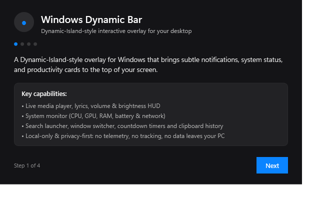

# Windows Dynamic Bar

**A modern, lightweight Dynamic-Island-style overlay for Windows 10 and Windows 11.**

[](https://github.com/Super-cod/dynamic-island/releases)
[](https://dotnet.microsoft.com/)
[](https://microsoft.com/windows)
[](LICENSE.md)

---

## Overview

**Windows Dynamic Bar** brings an interactive, context-aware pill interface to the top of your desktop. Inspired by mobile dynamic islands, it stays compact and unobtrusive during daily work, then smoothly expands with fluid spring physics when you play media, set timers, inspect hardware telemetry, search for apps, or adjust volume and display brightness.

The app is **100% local-only and privacy-first**: no background telemetry is transmitted to remote servers, no account is required, and your clipboard history remains encrypted on your machine using Windows DPAPI.


*Windows Dynamic Bar resting cleanly above your desktop workflow.*

---

## Key Features

- **Media Player & Visualizer** — Real-time album art, track details, seek progress, playback controls (Previous, Play/Pause, Next), and time-synchronized lyrics (LRCLib) with an optional rotating vinyl/CD disc animation.
- **System Telemetry & Hardware Monitor** — Real-time CPU usage, GPU engine load via DXGI enumeration, memory utilization rings, battery status with a 15% warning strip, and Per-Monitor DPI V2 support.
- **Search Launcher & Window Switcher** — Instant launcher (`Ctrl+Space`) with fuzzy app matching, window switching (`w `), and math/conversion evaluation.
- **Countdown Timer & Stopwatch** — Presets (5m, 10m, 25m, 45m), natural language parser (`15 min`, `90s`, `1:30`), and a retro digital LED countdown.
- **Encrypted Clipboard History** — `WM_CLIPBOARDUPDATE` event-driven capture with zero polling, DPAPI encryption at rest, and automatic password manager exclusions (1Password, KeePass, Bitwarden).
- **Network & Speed Test** — RSSI signal bars (`wlanapi.dll`), live transfer throughput, and integrated bandwidth/latency testing.
- **Volume & Brightness HUD** — Dynamic on-screen display with dot-matrix spectrum visualization when system sliders or volume keys change.
- **Customizable Appearance** — Dark, Light, and Translucent themes, 9 accent colors, adjustable corner radius, width, height, and animation speed.
- **Gaming & Fullscreen Protection** — Automatically hides in fullscreen games and video playback.

---

## Screenshot Gallery

| Collapsed Pill (Media & Clock) | Expanded Island Card |
| :---: | :---: |
|  |  |
| *Subtle pill showing current song and clock* | *Expanded card with media controls & telemetry* |

| Search Launcher (`Ctrl+Space`) | Countdown Timer & Stopwatch |
| :---: | :---: |
|  |  |
| *Fuzzy search, window switcher & math* | *Presets and digital LED countdown* |

| Network & Speed Test | System Telemetry Monitor |
| :---: | :---: |
|  |  |
| *Real-time throughput and speed test* | *Live CPU, GPU, and RAM telemetry* |

| Settings & Hotkey Recorder | About & Creator Attribution |
| :---: | :---: |
|  |  |
| *Customizable startup and hotkey binding* | *Creator attribution to Supercell & licence terms* |

*For more screenshots, see the [Full Screenshot Gallery](docs/SCREENSHOTS.md).*

---

## Download & Installation

Windows Dynamic Bar is distributed for **64-bit Windows** and does not require administrative privileges.

### Option 1: Installer (Recommended for Most Users)

1. Download **`WindowsDynamicBar-Setup.exe`** from the [Releases page](https://github.com/Super-cod/dynamic-island/releases).
2. Run the installer. It installs per-user into your local app directory (no admin prompt required).
3. Choose whether to start Windows Dynamic Bar with Windows and create a desktop shortcut.
4. Click **Finish** to launch the app.

### Option 2: Portable Zip (No Installation Required)

1. Download **`WindowsDynamicBar-Portable-win-x64.zip`** from [Releases](https://github.com/Super-cod/dynamic-island/releases).
2. Extract the archive into a folder of your choice (e.g. `C:\Tools\WindowsDynamicBar`).
3. Run **`WindowsDynamicBar.exe`**.

> **SmartScreen Note:** Because this application is released as community-built software without a paid commercial Authenticode certificate, Windows SmartScreen may show an *“Unrecognized app”* warning on first run. Click **More info** → **Run anyway**. You can verify file integrity using the SHA-256 checksums published with every release.

---

## First-Run Experience

When you launch Windows Dynamic Bar for the first time, a 4-step onboarding wizard will introduce you to core features, hotkeys, and permissions:



1. **Features Overview:** Summary of media, volume, telemetry, and search capabilities.
2. **Permissions:** Configure optional Windows notification and media session access.
3. **Shortcuts:** Review and customize the default keyboard hotkeys.
4. **Finish:** Places the collapsed pill at the top of your primary display.

---

## Keyboard Shortcuts

| Shortcut | Action | Configurable in Settings |
|---|---|:---:|
| `Ctrl+Space` | Open Search launcher & Window Switcher | Yes |
| `Ctrl+Alt+Space` | Toggle Dynamic Bar visibility | Yes |
| `Ctrl+Alt+M` | Open Media Player Card | Yes |
| `Ctrl+Alt+T` | Start or show 5-minute timer | Yes |
| `Ctrl+Alt+V` | Open Clipboard History | Yes |

*All shortcuts can be remapped in **Settings → General** with real-time conflict detection.*

---

## System Requirements

- **Operating System:** Windows 10 (Version 2004 / Build 19041 or higher) or Windows 11.
- **Architecture:** x64 (64-bit Intel / AMD).
- **Runtime:** Fully self-contained. You do **not** need to install Visual Studio or the .NET SDK to run the application.
- **Hardware:** Any modern laptop or desktop PC (typical memory footprint is ~60–90 MB).

---

## Settings & Customization

Open Settings by clicking the gear icon in the expanded island or right-clicking the system tray icon:

- **General:** Toggle *Start with Windows*, multi-monitor monitor selector, and collapse delays (300 ms – 10 s).
- **Island:** Configure which telemetry badges appear on the collapsed pill.
- **Features:** Selectively toggle Media, Clipboard, Volume HUD, Speed Test, Timers, and Camera Mirror.
- **Appearance:** Switch between Dark, Light, and Translucent themes; customize accent color; adjust corner radius and pill width.
- **Privacy:** Toggle clipboard monitoring, set clipboard history retention (1h, 6h, 24h, forever), and clear all local data.
- **About:** View original creator attribution, licence terms, log folder, and copy diagnostic reports.

---

## Troubleshooting & Common Questions

#### The bar is hidden behind another application
Windows Dynamic Bar is configured as `Topmost` by default. If another application forces itself on top, press `Ctrl+Alt+Space` to bring the island back to the foreground.

#### Dynamic Bar does not appear during games
By default, **Auto-Hide in Fullscreen** is enabled to prevent distracting overlays during games or video playback. You can disable this behavior in **Settings → General**.

#### Media information is not updating
Ensure your media player supports Windows Media Session (GSMTC). Spotify, Chrome, Edge, and modern players support this natively. For web players, ensure media playback is active and the browser is not muting the tab.

#### Where are settings and logs stored?
All configuration is stored locally under:
`%AppData%\WindowsDynamicBar`
- Settings: `%AppData%\WindowsDynamicBar\settings.json`
- Logs: `%AppData%\WindowsDynamicBar\logs\`

---

## Uninstall Instructions

- **If installed via Setup:** Open Windows **Settings → Apps → Installed apps**, locate **Windows Dynamic Bar**, and click **Uninstall**. The uninstaller cleanly removes all application files and optionally prompts whether to wipe local settings.
- **If using the Portable zip:** Exit the app from the system tray and delete the extracted folder. To remove cached configuration, delete `%AppData%\WindowsDynamicBar`.

---

## Developer Setup & Build Instructions

If you want to build or inspect the source code yourself:

### 1. Prerequisites
- [.NET 8.0 SDK](https://dotnet.microsoft.com/download/dotnet/8.0) (8.0.400 or later)
- Git for Windows
- [Inno Setup 6](https://jrsoftware.org/isdl.php) (optional, only needed to compile the installer)

### 2. Clone & Build
```powershell
# Clone the repository
git clone https://github.com/Super-cod/dynamic-island.git
cd dynamic-island

# Restore dependencies
dotnet restore WindowsDynamicBar.sln -m:1

# Build solution in Release configuration
dotnet build WindowsDynamicBar.sln -c Release --no-restore

# Run automated tests (83 passing tests)
dotnet run --project tests\WindowsDynamicBar.Tests\WindowsDynamicBar.Tests.csproj -c Release --no-build
```

### 3. Generate Release Packages
Run the automated packaging script to build the self-contained executable, compile the Inno Setup installer, and output SHA-256 checksums:
```powershell
.\build-release.ps1
```
Resulting artifacts will be located in the `release\` directory:
- `release\WindowsDynamicBar-Setup.exe` (per-user installer)
- `release\WindowsDynamicBar-Portable-win-x64.zip` (portable archive)
- `release\checksums.txt` (cryptographic SHA-256 hashes)

---

## Licence & Non-Commercial Policy

Windows Dynamic Bar is licensed as **Source-Available, Non-Commercial Software** under the [Supercell Source-Available Non-Commercial Licence](LICENSE.md).

### Summary of Terms:
- **Free for Personal Use:** Anyone may download, install, run, and modify the software for individual, personal, non-commercial purposes.
- **Free Redistribution:** You may share and redistribute unmodified or modified versions of the software free of charge, provided all copyright notices, attribution, and `LICENSE.md` remain intact.
- **No Commercial Use or Sale:** Selling the application, charging for downloads, bundling with paid software, hosting behind paywalls, or commercial use in business environments is strictly prohibited without prior written permission from Supercell.
- **OSI Clarification:** This is a custom source-available non-commercial licence; it is not an OSI-approved open-source licence.

*For complete legal terms, please read [LICENSE.md](LICENSE.md).*

---

## Creator Attribution

- **Original Creator & Maintainer:** **Supercell**
- **Copyright:** Copyright © 2026 Supercell. All rights reserved except as expressly permitted by the accompanying licence.
- **Repository:** [https://github.com/Super-cod/dynamic-island](https://github.com/Super-cod/dynamic-island)

---

## Third-Party Acknowledgements

Windows Dynamic Bar is built with the help of excellent open-source libraries:
- [NAudio & NAudio.Wasapi](https://github.com/naudio/NAudio) — Audio device endpoint monitoring and WASAPI capture (MIT Licence).
- [System.Management](https://github.com/dotnet/runtime) — WMI hardware telemetry and battery monitoring (MIT Licence).
- [Inno Setup](https://jrsoftware.org/) — Windows installer compiler by Jordan Russell and Martijn Laan.

*Full copyright notices are documented in [THIRD-PARTY-NOTICES.md](THIRD-PARTY-NOTICES.md).*

---

## Community & Feedback

- **Bug Reports:** [Submit an issue](https://github.com/Super-cod/dynamic-island/issues/new?template=bug_report.yml)
- **Feature Requests:** [Propose an enhancement](https://github.com/Super-cod/dynamic-island/issues/new?template=feature_request.yml)
- **Contributing Guide:** [CONTRIBUTING.md](CONTRIBUTING.md)
