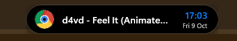
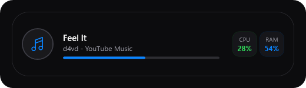
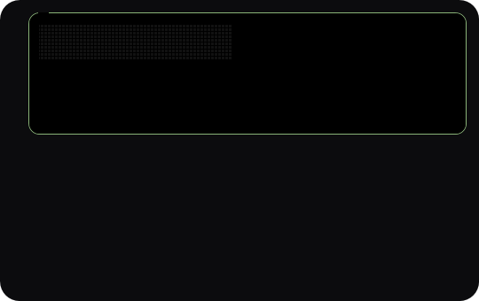
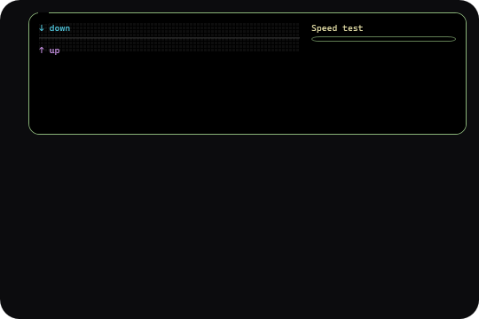
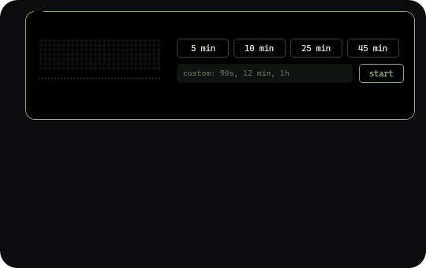
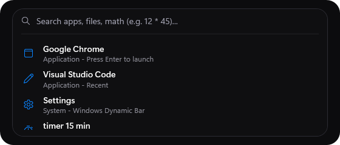
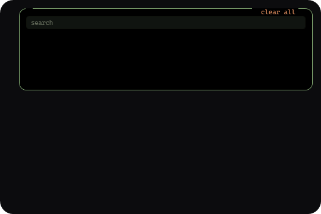
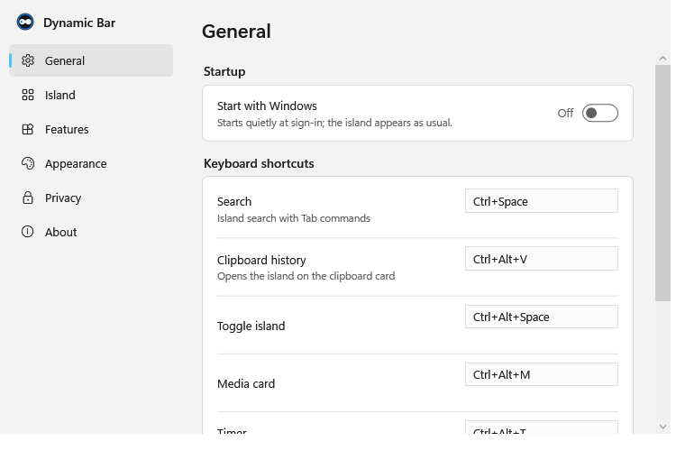
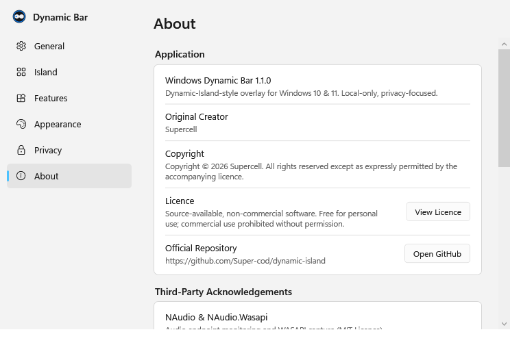

# Windows Dynamic Bar — Feature Guide

**Windows Dynamic Bar** brings an interactive Dynamic-Island-style pill to the top of your Windows 10 and 11 desktop. It remains subtle and compact during normal work, smoothly expanding when media plays, timers run, alerts occur, or system metrics require attention.

---

## 1. Dynamic Bar Core Interface

*Collapsed Dynamic Bar showing media badge, song info, clock, and date.*

- **What it does:** Sits centered at the top of your screen as a non-intrusive pill.
- **How to interact:**
  - **Hover:** Expands the island into a richer card with interactive controls.
  - **Click:** Optionally expand on single click (configurable in Settings).
  - **Middle-Click / Hotkey:** Toggle visibility instantly (`Ctrl+Alt+Space`).
- **Display elements:** Current time, date, battery status, active media title, and status badges.
- **Customization:** Configurable position (Top Center, Top Left, Top Right, Custom offset), width, height, corner radius, and opacity.
- **Fullscreen & Gaming:** Automatically hides when fullscreen games or video players are active.

---

## 2. Media Player & Synchronized Lyrics

*Expanded Island with active music track, progress bar, and system telemetry chips.*

- **What it does:** Detects playback from any Windows Media Session compatible app (Spotify, Apple Music, Chrome, Edge, Firefox, VLC, Windows Media Player).
- **Features:**
  - **Album Art & Disc Animation:** Album art rendered with an optional rotating vinyl/CD disc animation.
  - **Track Details:** Real-time track name, artist, and playback position.
  - **Playback Controls:** Previous, Play/Pause, Next buttons and seek scrubbing.
  - **Synchronized Lyrics:** Fetches and synchronizes time-stamped lyrics line-by-line via LRCLib when available.
- **Hotkey:** `Ctrl+Alt+M` directly opens the Media Card.
- **Privacy Note:** Media data is fetched entirely locally via Windows Media APIs; no listening history is sent to external servers.

---

## 3. System Telemetry & Hardware Monitor

*Live hardware telemetry monitoring panel.*

- **What it does:** Live monitoring of core system resources with low CPU overhead.
- **Information Displayed:**
  - **CPU:** Real-time utilization and clock frequency via Windows Performance Counters.
  - **GPU:** Dedicated GPU engine utilization and VRAM usage queried via DXGI adapter enumeration.
  - **RAM:** Memory usage percentage, active memory, and color-coded threshold rings (green, orange, red).
  - **Battery:** Percentage chip, AC charging lightning bolt glyph, and automatic 15% low-battery warning strip.
- **Performance Modes:** Balanced, Low Power, or Performance modes throttle background polling to preserve laptop battery.

---

## 4. Network Status & Speed Test

*Network panel with real-time throughput, connection stats, and speed test.*

- **What it does:** Real-time network throughput and Wi-Fi telemetry.
- **Features:**
  - **Wi-Fi Signal:** Honest signal bars mapped directly from RSSI dBm via `wlanapi.dll`.
  - **Throughput:** Live download and upload rate meters.
  - **Speed Test:** Integrated latency and throughput benchmark.
  - **Daily Usage:** Local tracking of daily received and transmitted megabytes.

---

## 5. Countdown Timer & Stopwatch

*Timer panel with quick presets, custom duration parser, and dot-matrix countdown.*

- **What it does:** Precision desktop timer and stopwatch.
- **Interaction:**
  - **Presets:** Quick buttons for 5 min, 10 min, 25 min (Pomodoro), and 45 min.
  - **Custom Input:** Flexible natural parser supporting `90s`, `15 min`, `1h30m`, `1:30`.
  - **Dot-Matrix Display:** Retro digital LED font rendering remaining time directly in the expanded pill.
- **Hotkey:** `Ctrl+Alt+T` starts or shows the active timer.

---

## 6. Search Launcher & Window Switcher

*Search launcher with application shortcuts, file search, and math evaluation.*

- **What it does:** Instant application launcher and multi-tool accessible from anywhere.
- **How to open:** Press `Ctrl+Space`.
- **Capabilities:**
  - **App Search:** Smart fuzzy ranking with typo tolerance and usage boosts.
  - **Window Switcher:** Type `w ` to filter and switch between open desktop windows.
  - **Math & Conversions:** Instant math evaluation (e.g., `12 * 45`, `sqrt(144) + sin(0)`).
  - **Island Commands:** Direct commands such as `timer 10 min`, `stopwatch`, or `settings`.

---

## 7. Clipboard History

*Encrypted local clipboard history manager.*

- **What it does:** Captures clipboard updates via `WM_CLIPBOARDUPDATE` (event-driven, zero polling).
- **Security & Privacy:**
  - **Encrypted at rest:** Protected with Windows DPAPI (`CurrentUser`).
  - **Password Manager Exclusion:** Automatically ignores entries copied from KeePass, 1Password, Bitwarden, and sensitive apps.
  - **Auto-Clear:** Configurable auto-purge after 1, 6, or 24 hours.
- **Hotkey:** `Ctrl+Alt+V`.

---

## 8. Settings & Customization

*Comprehensive settings and hotkey customization.*

*About tab displaying creator attribution to Supercell, licence terms, and repository links.*

- **General:** Startup with Windows, multi-monitor display selection, collapse delays.
- **Appearance:** Dark, Light, and Translucent themes; custom accent color palette; slider corner radius and bar dimensions.
- **Keyboard Shortcuts:** Live recorder allowing remapping of all core shortcuts with conflict detection.
- **About:** Original creator attribution (**Supercell**), licence details, source repository links, diagnostic reports, and logs.
