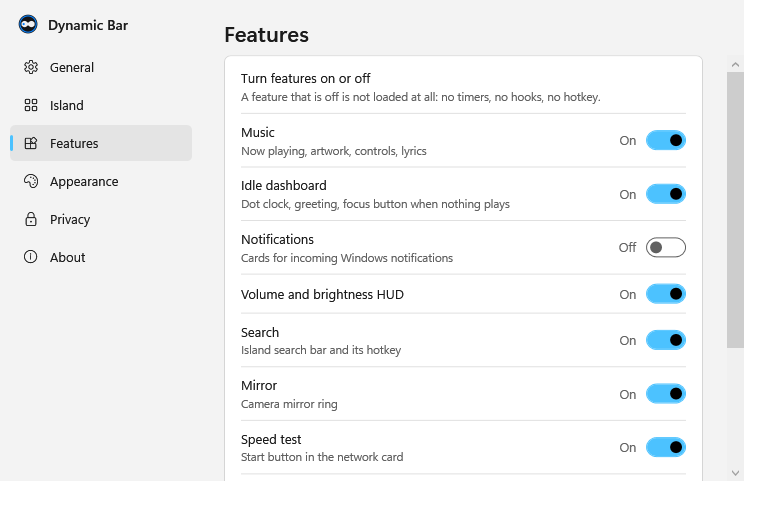
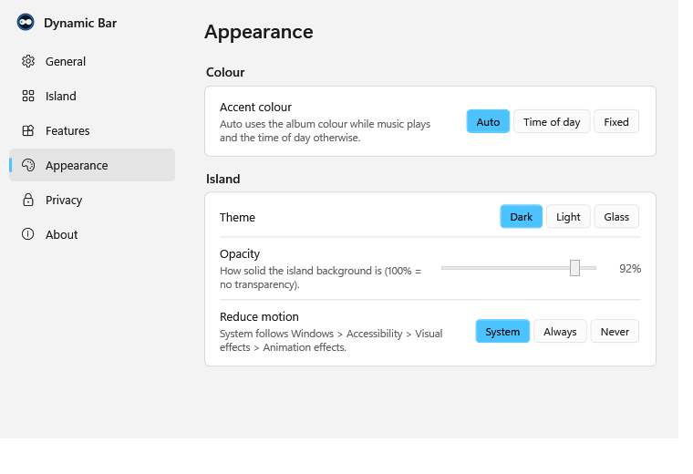
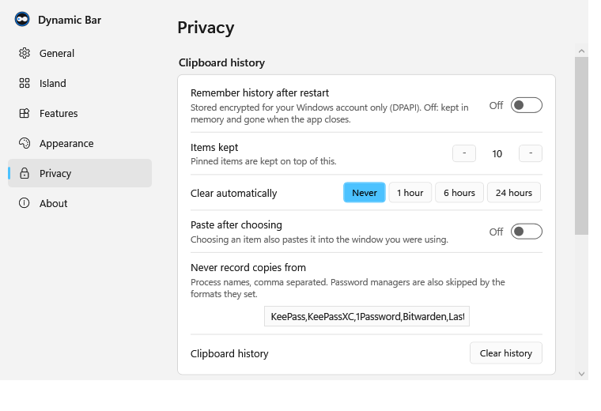

# Windows Dynamic Bar — Screenshot Gallery

A visual tour of the real **Windows Dynamic Bar** interface running on Windows 11.

---

### Collapsed Desktop Island

*Collapsed Dynamic Bar showing active application icon, music track title, and real-time clock.*

---

### Desktop Overview

*Dynamic Bar seamlessly overlaying the top of the Windows desktop without blocking browser tabs.*

---

### Expanded Island Card

*Expanded Island with active media playback, progress scrubbing, and real-time CPU/RAM telemetry chips.*

---

### Search Launcher & Window Switcher

*Search interface triggered via Ctrl+Space with app launcher, file lookup, and tab commands.*

---

### Timer & Stopwatch

*Countdown timer panel with one-click presets, custom duration parser, and digital LED countdown.*

---

### Network & Speed Test

*Network telemetry panel with live upload/download rate meters and speed testing.*

---

### System Telemetry Monitor

*Hardware monitor detail panel for CPU, GPU engine utilization, and RAM.*

---

### Clipboard History

*DPAPI-encrypted clipboard history with pinned entries and password manager protection.*

---

### First-Run Setup Wizard

*Onboarding wizard walking new users through features, permissions, and keyboard shortcuts.*

---

### Settings — General & Hotkeys

*General settings panel with startup toggle and interactive keyboard shortcut recorder.*

---

### Settings — Features

*Individual toggle switches to enable or disable specific widgets and background monitors.*

---

### Settings — Appearance

*Theme customization supporting Dark, Light, Translucent modes, accent colors, and bar dimensions.*

---

### Settings — Privacy

*Local-only privacy controls with clipboard exclusions and logging settings.*

---

### Settings — About & Creator Attribution

*About tab showing original creator attribution to Supercell, licence terms, repository link, and diagnostic tools.*
